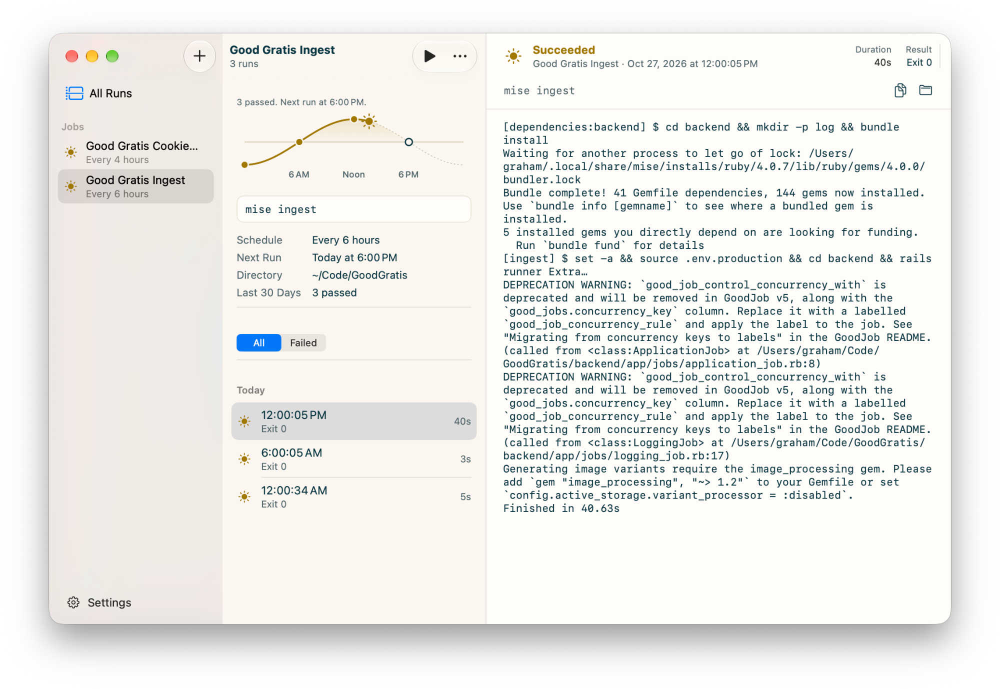

# Sundial

<p align="center">
  
</p>

Sundial is a small native macOS app for running your own shell commands on a schedule and seeing, at a glance, whether each run passed or failed.

## Install

```sh
brew install grahamotte/tap/sundial
```

Or download the latest `Sundial-macos-<version>.zip` from [Releases](https://github.com/grahamotte/Sundial/releases), unzip it, and move `Sundial.app` to `/Applications`. Builds are signed with a Developer ID and notarized by Apple.

Sundial requires macOS 27 or later. Update a Homebrew install with `brew upgrade`.

## Using Sundial

Each job is a command, a working directory, and a schedule. Sundial hands the schedule to launchd, so jobs run whether or not Sundial is open, and it keeps the output, exit status, and duration of every run from the last 30 days.

Open Sundial and add a job with **New Job** (⌘N). The first time it installs a job, macOS shows a "Background Items Added" notification for Sundial. That is expected: each job is a launch agent, listed under Sundial in System Settings → General → Login Items & Extensions.

- **Jobs** are listed in the sidebar with the result of their latest run: a sun for a pass, a red storm cloud for a failure, a red cloud for an interrupted run, a turning sun while running, or a sunrise for a job that hasn't run yet.
- **Today** is drawn as the sun's path across the day, above the runs and in the menu bar. Each of today's runs sits on the path at the time it started, the sun marks the current time, and a hollow ring marks the next scheduled run.
- **Runs** for the selected job are grouped by day. **All Runs** shows every job's runs together, and the **Failed** filter shows only failures.
- **Output** for the selected run shows the full combined stdout and stderr, along with the start time, duration, and exit code. Copy it, or show the log file in Finder.
- **Run Now** (⌘R) runs a job immediately, even if it is disabled. **Edit** (⌘E), **Duplicate**, **Enabled**, and **Delete** are in the toolbar's More menu and in the sidebar's context menu.

A run passes when its command exits with status 0. A non-zero exit, a termination signal, or a run that was cut off (shown as **Interrupted**) counts as a failure.

### Menu bar and settings

Sundial adds a sundial icon to the menu bar. Click it to see the 10 most recent runs across all jobs with their pass/fail status. Choose a run to open it in the main window, or choose **View All Runs…**. While the menu bar icon is shown, closing the main window leaves Sundial running in the menu bar.

**Settings**, at the bottom of the sidebar (⌘,), has two options: **Show in menu bar** (on by default) and **Open at login**.

### Schedules

| Repeat | Options |
| --- | --- |
| Repeatedly | Every 1, 5, 10, 15, or 30 minutes, or every 1, 2, 3, 4, 6, 8, or 12 hours, aligned to the clock (for example, every 6 hours runs at 12 AM, 6 AM, 12 PM, and 6 PM) |
| Daily | At a set time |
| Weekly | At a set time on chosen days |

If your Mac is asleep when a job is due, launchd runs it once when the Mac wakes, rather than once for every missed time.

### How commands run

- Commands run with `/bin/zsh -c` in the job's working directory (your home folder by default). Multi-line commands and `&&` chains work as they do in Terminal.
- `PATH` starts with mise shims, `~/.local/bin`, and Homebrew (`/opt/homebrew/bin`), followed by the system paths, so tools installed with mise or Homebrew work without extra setup.
- zsh does not run as a login shell, so `~/.zprofile` and `~/.zshrc` are not loaded; `~/.zshenv` is. Put anything a job needs, such as environment variables, in the command itself or in a script the command calls.
- If a command reads from a folder macOS protects, such as Desktop, Documents, or another app's data, macOS may ask you to allow Sundial access in System Settings → Privacy & Security.
- Logs over 5 MB keep only their last 5 MB.

### Where Sundial keeps things

| Path | Contents |
| --- | --- |
| `~/Library/Application Support/Sundial/jobs.json` | Your jobs |
| `~/Library/Application Support/Sundial/Runs/` | One `.json` record and one `.log` file per run |
| `~/Library/LaunchAgents/com.grahamotte.sundial.job.<id>.plist` | One launch agent per enabled job, running `Sundial.app/Contents/MacOS/Sundial run <id>` |

Sundial creates, updates, and removes only launch agents with the `com.grahamotte.sundial.job.` prefix.

### Uninstall

1. In Sundial, delete every job. This removes their launch agents.
2. Quit Sundial and run `brew uninstall --zap sundial`, which also deletes Sundial's data and preferences. If you installed it by hand, move it to the Trash and delete `~/Library/Application Support/Sundial` and `~/Library/Preferences/com.grahamotte.sundial.plist`.

## Contributing

Issues welcome.

## License

[MIT](LICENSE)
